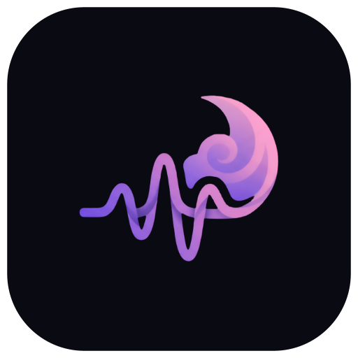

<p align="center">
  
</p>

<h1 align="center">Daydreamin</h1>

<p align="center">
  <b>Music from everywhere, played beautifully.</b><br>
  A free music app for <b>Android, Mac, Windows and Linux</b> — no account, no ads, no subscription.
</p>

<p align="center">
  <a href="#-download"><b>⬇ Download</b></a> ·
  <a href="#-whats-inside">What's inside</a> ·
  <a href="#-installing">Installing</a> ·
  <a href="https://www.buymeacoffee.com/theankitverse">Buy me a coffee</a>
</p>

Daydreamin plays any song straight from YouTube, found and streamed right on your device — there's
no server of ours in between, and nothing to sign up for. It learns what you like and builds your
Home around it, shows synced lyrics, keeps songs for offline listening, and wraps it all in a dark,
liquid-glass design. The same app runs on your phone and your computer.

## ✨ What's inside

- **A Home that learns you.** Your plays, likes and skips shape *Your Daydream Mix*, top picks and
  shelves like *Because you like …* and *Fresh finds* — worked out on your device, and refreshed as
  your listening changes. New here? It starts with what's popular in your country.
- **Search anything** — a song, an artist, or a line from the lyrics you half remember.
- **Synced lyrics** that follow the song line by line, Apple Music-style.
- **Offline listening.** Download any song or whole playlist and play it with no connection. (Liked
  songs too, if you turn that on.)
- **Plays like a proper music app:** crossfade between songs, gapless playback, an equalizer, a
  loudness boost, shuffle, repeat, a queue you can reorder, and a sleep timer.
- **Your library:** liked songs, your own playlists, saved YouTube playlists, history and listening
  stats. Export it to a file and import it on another device.
- **Make it yours:** your name, photo and an accent colour that lights up the whole app.
- **On your computer:** a sidebar on wide windows, keyboard shortcuts, your keyboard's media keys,
  and the system's Now Playing controls (Control Center on Mac, media controls on Linux).
- **Updates itself.** New versions show up right in the app.

## ⬇ Download

| Your device | Download | Size | Is this mine? |
|---|---|---|---|
| **Android** phone or tablet | [**Daydreamin.apk**](https://github.com/theankitverse/daydreamin-android/releases/latest/download/Daydreamin.apk) | ~5 MB | Android 5.0 or newer |
| **Mac** with Apple chip | [**Daydreamin-macos-arm64.dmg**](https://github.com/theankitverse/daydreamin-android/releases/download/desktop-latest/Daydreamin-macos-arm64.dmg) | ~120 MB | Apple menu → About This Mac says **Chip: Apple M1, M2, M3…** |
| **Mac** with Intel chip | [**Daydreamin-macos-x64.dmg**](https://github.com/theankitverse/daydreamin-android/releases/download/desktop-latest/Daydreamin-macos-x64.dmg) | ~125 MB | Apple menu → About This Mac says **Processor: Intel…** |
| **Windows** | [**Daydreamin-windows.msi**](https://github.com/theankitverse/daydreamin-android/releases/download/desktop-latest/Daydreamin-windows.msi) | ~110 MB | Windows 10 or 11, 64-bit |
| **Linux** (Debian family) | [**Daydreamin-linux-amd64.deb**](https://github.com/theankitverse/daydreamin-android/releases/download/desktop-latest/Daydreamin-linux-amd64.deb) | ~105 MB | Ubuntu, Debian, Linux Mint, Pop!_OS, Zorin — 64-bit PC |
| **Linux** (Red Hat family) | [**Daydreamin-linux-x86_64.rpm**](https://github.com/theankitverse/daydreamin-android/releases/download/desktop-latest/Daydreamin-linux-x86_64.rpm) | ~115 MB | Fedora, openSUSE, RHEL — 64-bit PC |

These links always give you the newest version. After you install, the app keeps itself up to date.

## 📲 Installing

**Android**
1. Open the downloaded **Daydreamin.apk** (from the notification or the Files app).
2. If Android asks, allow installs from your browser or Files app, then go back.
3. Tap **Install**, then **Open**.

**Mac**
1. Open the downloaded **.dmg** and drag **Daydreamin** into **Applications**.
2. Open Daydreamin from Applications.
3. The first time only: macOS says it can't check the app. Go to **System Settings → Privacy &
   Security**, scroll down and click **Open Anyway**.

**Windows**
1. Run the downloaded **.msi**.
2. If you see *"Windows protected your PC"*, click **More info → Run anyway**.
3. Follow the installer, then open **Daydreamin** from the Start menu.

**Linux**
1. Open the downloaded file with your software installer and click **Install** — or in a terminal:
   `sudo apt install ./Daydreamin-linux-amd64.deb` (Fedora: `sudo dnf install ./Daydreamin-linux-x86_64.rpm`).
2. Open **Daydreamin** from your apps.

The one-time warnings on Mac and Windows appear because the app isn't signed with a paid
developer certificate — it's a free, personal project.

**Bringing your library over:** on one device, **Settings → Export library**; on the other,
**Settings → Import library**.

**Keyboard shortcuts on a computer:** <kbd>Space</kbd> play/pause · <kbd>Cmd/Ctrl</kbd> + <kbd>←</kbd>/<kbd>→</kbd>
previous/next · <kbd>Shift</kbd> + <kbd>←</kbd>/<kbd>→</kbd> seek 10 s · <kbd>Cmd/Ctrl</kbd> + <kbd>F</kbd> search ·
<kbd>Esc</kbd> back.

## 🛠 How it's built

Kotlin and Compose Multiplatform: one codebase for the Android app and the desktop app. Songs are
found and streamed on the device with [NewPipeExtractor](https://github.com/TeamNewPipe/NewPipeExtractor);
lyrics come from [LRCLIB](https://lrclib.net/). This is a separate project from
[Daydreamin's original web app](https://github.com/theankitverse/Daydreamin).


- `app/src/commonMain` — everything shared: screens, theme, YouTube extraction, library,
  recommendations, settings.
- `app/src/androidMain` — the Android app: Media3 playback in a foreground service, downloads,
  the APK updater.
- `app/src/desktopMain` — the desktop app: its own Opus player (decoded in plain Java, with
  crossfade and an equalizer), downloads, Now Playing / MPRIS / media keys, and its updater.

```bash
git clone https://github.com/theankitverse/daydreamin-android.git
cd daydreamin-android
./gradlew assembleDebug        # Android APK → app/build/outputs/apk/debug/
./gradlew :app:run             # the desktop app, on this computer
./gradlew :app:packageDmg      # or packageMsi / packageDeb / packageRpm (on that system)
```

Requires JDK 21 (a full one, with `jpackage`, for the desktop installers) and the Android SDK
(`compileSdk 35`, `minSdk 21`, so Android 5.0 and up). Desktop installers are built and published
by `.github/workflows/desktop.yml` for every `desktop-v*` tag.

## ☕ Support

Daydreamin is free, with no ads and no account required. If you'd like to support the project,
you can [buy me a coffee](https://www.buymeacoffee.com/theankitverse) — completely optional,
and it doesn't unlock anything, since there's nothing locked to begin with.

## 🔒 Privacy

No account, no ads, and nothing about what you listen to ever leaves your device. To see roughly how
many people use the app, the Android app sends one anonymous count a day to
[TelemetryDeck](https://telemetrydeck.com) (a privacy-focused analytics service): a random ID made
on the phone (hashed before sending), the app and Android version, the country, and which app
installed Daydreamin. Never songs, searches, your name or anything else. Turn it off in
**Settings → Share anonymous usage stats**.

## A note on how this works

This app plays audio by resolving stream URLs directly from YouTube (via NewPipeExtractor) rather
than through YouTube's official Data API. That's the same approach used by
[NewPipe](https://github.com/TeamNewPipe/NewPipe) and similar projects. It's shared here as a
personal, source-available project rather than distributed through an app store.

---

Made by [Ankit](https://www.instagram.com/ankitchaurasiya.o_o/).
